<div align="center">



**🌐 Версии:** [English](README.md) · [Русский](README.ru.md) · [Сайт](https://bestdeejay-design.github.io/neo-consulting/) · [Презентация](https://bestdeejay-design.github.io/neo-consulting/presentation/)

</div>

# НЕО КОНСАЛТИНГ — лендинг бухгалтерского аутсорсинга

Статический лендинг для **ООО «НЕО КОНСАЛТИНГ»** — бухгалтерские, налоговые и
юридические услуги для ИП и ООО на УСН в Санкт-Петербурге.

Собран на чистом HTML/CSS/JS без сборщиков и **без внешних запросов** — все шрифты,
иконки, изображения и метаданные локальные.

## Статус проверок

| Проверка | Результат |
|---|---|
| Lighthouse mobile | **100 / 100 / 100 / 100** |
| Lighthouse desktop | **91 / 100 / 100 / 100** (порог 90) |
| meta_audit | 17/18 (одно известное ложное срабатывание) |
| `scripts/seo_audit.py` | **199 проверок · 0 ошибок · 5 предупреждений** (все — про отсутствующие контактные данные) |
| html-validate | 0 ошибок (3 warning в служебной презентации) |
| Контраст WCAG AA | все пары текст/фон ≥ 4.5:1 |
| Raw hex вне дизайн-токенов | 0 |

## SEO и социальная оптимизация

- Отчёт аудита, варианты расширения и план: [`docs/SEO_AUDIT_2026-10-26.md`](docs/SEO_AUDIT_2026-10-26.md)
- Что нужно от владельца (данные, доступы, решения): [`docs/SEO_INPUTS.md`](docs/SEO_INPUTS.md)
- Решения по SEO: [`docs/DECISIONS.md`](docs/DECISIONS.md) (D-008 … D-013)
- Воспроизводимая проверка: `python3 scripts/seo_audit.py` (запускается в CI)
- Разметка: `Organization` (`AccountingService` + `ProfessionalService`, `hasOfferCatalog`),
  `WebSite`, `Blog`, `Article` с автором-`Person`, `FAQPage`, `BreadcrumbList`
- Соцслой: OG/Twitter-карточки с `og:image:alt`, блок «Поделиться», RSS-фид
  `materials/feed.xml`
- Известное ограничение: сайт на подпути `github.io`, поэтому `robots.txt` роботы
  не читают — индексация управляется мета-тегом robots и sitemap (см. D-013)

## Материалы и страницы-кластеры

- 13 справочников и практических разборов в `materials/`
  с автором, датами публикации и обновления, FAQ-разметкой и OG-карточками
- Коммерческие кластеры: смена бухгалтера, штат vs аутсорсинг, зарплата и кадры, регистрация/закрытие, АНО, ОСНО
- RSS-фид: `materials/feed.xml`, OG-генератор: `scripts/make_og.py`

## Живой сайт

- **Сайт:** [bestdeejay-design.github.io/neo-consulting](https://bestdeejay-design.github.io/neo-consulting/)
- **Презентация:** [bestdeejay-design.github.io/neo-consulting/presentation](https://bestdeejay-design.github.io/neo-consulting/presentation/)
- **Материалы:** [bestdeejay-design.github.io/neo-consulting/materials](https://bestdeejay-design.github.io/neo-consulting/materials/)

## Быстрый старт

```bash
# открыть напрямую
open index.html

# или локальный сервер
python3 -m http.server 8377
```

## Возможности

- **17 секций лендинга** (`hero`, `problems`, `solution`, `services`, `details`,
  `audience`, `pricing`, `process`, `about`, `team`, `gallery`, `guarantees`, `cases`,
  `reviews`, `faq`, `guides`, `contacts`) с якорной навигацией
- **Ротация фото**: 12 локальных фото 4:3 перемешиваются по 8 позициям `data-slot`
  при каждой загрузке страницы (hero берётся из приоритетного пула, дубли в пределах
  страницы исключены, последний hero запоминается в `localStorage`, без JS работает
  дефолтная раскладка)
- **Семантический HTML**: единственный `<h1>`, иерархия заголовков по WCAG,
  FAQ-аккордеон на нативных `<details>/<summary>`, таблица тарифов с горизонтальным
  скроллом на мобильных
- **Дизайн-токены**: все цвета объявлены один раз в `css/tokens.css` (`:root`),
  ноль raw-hex вне токенов; сдержанный пихтово-зелёный акцент `#2E5E4E`
- **Доступность**: контраст 4.5:1, состояния `:focus-visible`, тап-зоны от 44px,
  `scroll-padding-top` для фиксированной шапки, ARIA-метки
- **SEO-слой**: canonical, Open Graph / Twitter-карточки (1200×630), JSON-LD
  `ProfessionalService` + `FAQPage`, `robots.txt`, `sitemap.xml`, favicon
- **Только локальные изображения**: сгенерированные аватарки, фото офиса, OG-картинка —
  без CDN
- **Адаптив**: mobile-first, брейкпоинты 640px и 960px, меню-бургер
- **Продающая презентация**: самодостаточный интерактивный дека из 12 слайдов (`presentation/`) — заметки спикера, таймер, навигация с клавиатуры
- **Библиотека материалов**: 7 SEO-готовых гайдов (налоговый календарь, автоматизация 1С, ЭТрН, НДС/УСН, взносы ИП, объект УСН, амнистия) со своими OG-картинками и якорной навигацией

## Структура репозитория

```
.
├── index.html              # лендинг (17 секций, JSON-LD, OG/Twitter)
├── presentation/
│   └── index.html          # интерактивная презентация (12 слайдов, самодостаточная)
├── deck/                   # комплект продающей презентации: deck.pptx/pdf/json, slides.html, черновики гайдов, превью слайдов
├── design/                 # дизайн-документы: design-system, story-brief, outline, ранняя презентация
├── materials/
│   ├── index.html          # библиотека материалов (13 гайдов)
│   ├── feed.xml            # RSS-фид гайдов
│   ├── smena-buhgaltera.html      # смена бухгалтера: передача учёта
│   ├── shtatny-buhgalter-ili-autsorsing.html  # штатный бухгалтер или аутсорсинг
│   ├── zarplata-i-kadry.html      # зарплата и кадры
│   ├── registraciya-i-zakrytie.html  # регистрация и закрытие ИП/ООО
│   ├── avtonomnaya-nekommercheskaya-organizaciya.html  # АНО: налоги и отчётность
│   ├── osno.html                  # ОСНО против УСН
│   ├── 1c-automation-guide.html
│   ├── etrn-guide.html
│   ├── nds-usn-2026.html
│   ├── calendar-2026.html
│   ├── ip-vznosy-2026.html
│   ├── usn-object.html
│   └── amnistia.html
├── css/
│   ├── tokens.css          # дизайн-токены (кастомные свойства :root)
│   └── main.css            # стили (mobile-first)
├── js/
│   ├── main.js             # меню, текущий год, закрытие по Escape/resize
│   └── photos.js           # ротация фото по позициям data-slot
├── assets/
│   ├── img/                # аватарки, фото hero/офиса, OG-картинки, favicon
│   │   ├── og/             # OG-превью гайдов (1200×630)
│   │   └── photos/         # пул ротации: photo-*.webp (4:3, 12 файлов)
│   ├── header.svg          # анимированная шапка README (SMIL)
│   └── footer.svg          # анимированный подвал README (SMIL)
├── docs/
│   ├── content.md          # тексты секций лендинга
│   ├── VISION.md           # продуктовая документация (L1)
│   ├── PRD.md
│   ├── ROADMAP.md
│   ├── TEST_PLAN.md
│   ├── DECISIONS.md
│   ├── SEO_AUDIT_2026-10-26.md
│   ├── SEO_INPUTS.md
│   └── plans/              # план разработки
├── .github/
│   ├── ISSUE_TEMPLATE/     # формы issue (баг/фича)
│   ├── pull_request_template.md
│   └── workflows/
│       └── ci.yml          # CI: проверки h1/секций/raw-hex/SEO-меты
├── CHANGELOG.md            # история релизов
├── LICENSE                 # MIT
├── CODE_OF_CONDUCT.md      # Contributor Covenant 2.1
├── CONTRIBUTING.md
├── SECURITY.md
├── SUPPORT.md
├── scripts/
│   ├── seo_audit.py        # воспроизводимый SEO/соц-аудит (запускается в CI)
│   └── make_og.py          # генератор OG-картинок (1200×630)
├── 404.html                # страница ошибки (noindex)
├── robots.txt
└── sitemap.xml
```

## Документация

Продуктовая документация (L1) — в [`docs/`](docs/): VISION, PRD, ROADMAP,
TEST_PLAN и DECISIONS. Тексты секций лендинга — в [`docs/content.md`](docs/content.md).

---

<div align="center">


</div>